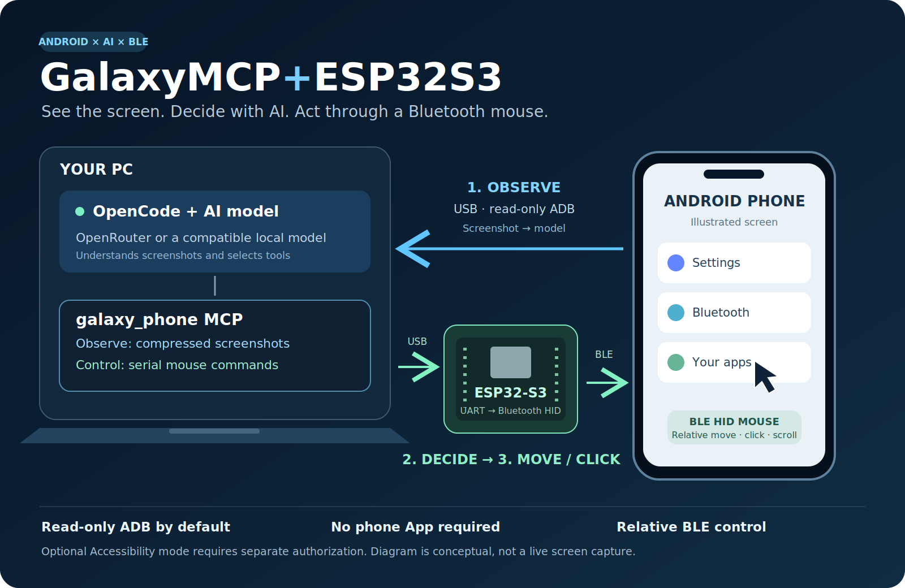

# GalaxyMCP+ESP32S3

[繁體中文](#traditional-chinese) · [English](#english)

**讓 OpenCode 看懂 Android 畫面，再經 ESP32-S3 藍牙滑鼠操作手機。**  
**Let OpenCode observe your Android screen and operate a Bluetooth mouse through an ESP32-S3.**



**Beta · Windows 10/11 · Android · ESP32-S3 · OpenCode · OpenRouter or a compatible local model**

<a id="traditional-chinese"></a>

## 繁體中文

### 這個專案是甚麼？

GalaxyMCP+ESP32S3 是連接 **AI 助理與 Android 手機**的本機橋接程式。你在 OpenCode 輸入指令，AI 經 MCP 取得手機畫面，再透過 ESP32-S3 的藍牙 HID 滑鼠功能移動、點擊或捲動。

**例如：**「描述目前畫面」、「向下捲動一次，再告訴我有甚麼新內容」，或「向右移動滑鼠一次」。開啟 App 或選擇按鈕需要可靠的指標位置及結果驗證，並非輸入名稱就能保證精準點擊。

專案本身不包含 AI 模型；需要 OpenCode 和支援圖片及工具呼叫的模型。預設流程不需要在手機安裝輔助 App。

### 可以做甚麼？

- 讀取手機截圖，交由你選用的 AI 模型理解畫面。
- 經 USB 串口向 ESP32-S3 發出指令，由 BLE HID 滑鼠移動、點擊及捲動。
- 預設 ADB **只讀**；Python 程式只允許裝置列表、截圖及必要的顯示尺寸／方向查詢。
- 截圖預設長邊 1280、JPEG quality 65；重用觀察，減少重複擷取與模型來回。
- 回報 `capture_ms`、`total_ms`、`returned_bytes`，協助量度擷取及壓縮時間。
- 另附需要明確授權的 Accessibility App／ADB 輸入模式，供私人或已獲管理員批准的環境使用。

**目前可行的核心流程：** 觀察截圖 → AI 判斷 → ESP32 相對移動／點擊 → 新觀察確認。
這不是手機畫面串流或即時視覺模型，也不保證每個 App 都能自動操作。

### 適合哪些用途？

| 用途 | 如何使用 |
|---|---|
| 畫面解讀 | 擷取目前介面，請 AI 描述可見內容 |
| 輔助導覽 | 透過 ESP32 移動、點擊及捲動，再觀察結果 |
| 示範與學習 | 展示「手機畫面 → AI 判斷 → 藍牙輸入」的完整流程 |
| 開發與測速 | 使用 MCP 工具及耗時資料，研究不同模型和截圖設定 |

## 你需要

| 項目 | 要求 |
|---|---|
| 電腦 | Windows、Python 3.10+、OpenCode、Android platform-tools |
| 手機 | Android，解鎖並授權 USB 偵錯 |
| 控制板 | ESP32-S3；目前韌體以 DNESP32S3B N16R8 測試 |
| 連接 | 手機 USB → PC；ESP32 UART USB → PC；手機與 ESP32 BLE 配對 |
| 模型 | 工具呼叫及圖片輸入；OpenRouter 的模型能力需自行確認 |

模型可改用支援圖片及工具的本機服務，MCP 本身不儲存模型 API Key。本機效能取決於硬件。

## 快速開始

### 1. 下載及設定電腦

1. 在 GitHub 按 **Code → Download ZIP**，全部解壓到固定資料夾。
2. 先安裝 Python、OpenCode 及 Android platform-tools。
3. 雙擊 `SETUP.cmd`；程式自動尋找 adb.exe，找不到時會要求完整路徑。
4. 接好手機與 ESP32。手機 USB 偵錯需手動授權。
5. 關閉 Arduino Serial Monitor，避免佔用串口。預設串口是 COM4，可在本地 `bridge.json` 改成自己的串口。
6. 雙擊 `START_OpenCode.cmd`，或以 OpenCode Desktop 開啟這個資料夾。

設定程式建立 `.venv`、私人 `bridge.json` 及專案 `opencode.json`。已有的 OpenCode 設定會先備份並保留其他 provider/MCP 欄位。不要將私人設定提交到 Git。

### 2. 準備 ESP32

韌體在 [`firmware/GalaxyMouse/GalaxyMouse.ino`](firmware/GalaxyMouse/GalaxyMouse.ino)，完整步驟見 [ESP32 設定](docs/FIRMWARE.md)。
如果你的板已運行 **Jimmy Phone Mouse v2** 並正常連接，毋須再刷寫。否則先備份原廠韌體，再以指定 Arduino core 編譯。手機藍牙手動配對後，用 `esp32_status` 確認 `ready=true`。

### 3. 將這段貼入 OpenCode

> 使用 galaxy_phone MCP。先讀 connection_info，確認 adb_read_only=true，再讀 esp32_status。以 phone_screenshot(max_side=1280, quality=65) 描述目前手機畫面，回報 capture_ms、total_ms、returned_bytes。暫時不要點擊。之後只用 ESP32 BLE 操作；不要執行安裝、配對、UI dump 或 ADB 輸入。操作後有需要才重新擷取畫面驗證。

先測試單次移動，再測試點擊。相對滑鼠位置可能無法從截圖看見；不要猜測指標座標或宣稱點擊一定成功。

## 主要工具

| 工具 | 預設模式 |
|---|---|
| `connection_info` | 列出串口、手機及 bridge_version=3.1 |
| `esp32_status` | 查看 BLE、加密、訂閱及準備狀態 |
| `esp32_mouse` | `left/right/up/down/click/scrollup/scrolldown` |
| `phone_screenshot` | 壓縮 JPEG；`full_resolution=true` 可取原尺寸 PNG |
| `phone_ui`、`phone_click_*` | 預設停用；需要授權的非唯讀環境 |
| `adb_tap/swipe/key/type_ascii` | 預設停用 |
| `phone_app_status` | 唯讀模式只回報 App 通道不可用 |

`adb_read_only=true` 會在執行 ADB 前檢查命令，並優先於 `adb_actions`。這是本橋接的限制，不代表改變或取代公司端點管理政策。公司環境只使用已批准的命令和 BLE 控制。

## 速度及已知限制

- 壓縮減少交予模型的圖片大小；手機仍需產生原始 PNG，沒有省去這部分時間。
- OpenRouter／模型排隊與推理仍可能佔主要等待時間；免費模型的反應時間會變動。
- 一次滑鼠移動為 **40 HID units，不是 40 螢幕像素**；Android 指標加速會影響距離。
- ESP32 是相對滑鼠，不是座標點擊器；截圖可能不包含游標。
- 需要細字時才取高解像度，避免每次操作前後都重複截圖。
- 沒有提供 BLE 鍵盤、中文輸入、scrcpy 串流或 OCR。
- Accessibility 可讀到的節點取決於 App／系統；遊戲、自繪畫面及受保護內容未必有可用結構。
- APK 已編譯及驗證開發簽章；尚未在每個 One UI 版本做實機驗證。

## 可選：Accessibility 輔助 App

預設唯讀流程**不需要安裝 APK、不需要配對 App 或開啟無障礙權限**。

附帶的 [`GalaxyPhoneBridge.apk`](GalaxyPhoneBridge.apk) 及 [完整源碼](android/) 僅供已獲批准的非唯讀環境。它經 ADB forward 通訊，配對亦需寫入 App 私有資料；**手動安裝 APK 不等於已完成配對**。

若公司只批准 ADB 讀取，請維持預設模式。不要用其他安裝或通訊方式規避限制。由管理員確認需要的權限後，再按 [Accessibility 安裝與配對](README_TC.md) 操作。

## Privacy / 私隱

手機截圖和可選 UI 文字會透過 OpenCode 交予你選用的模型供應商。App 本身沒有 Internet 權限。觀察資料不會由橋接自動寫成歷史檔案，但模型客戶端／供應商的記錄政策需另行確認。

不要提交 `bridge.json`、`opencode.json`、配對 token、API Key、裝置序號、截圖或私人備份。遇到密碼、PIN 及生物辨識提示，交由裝置持有人處理。發送訊息、購買、刪除等操作需有明確授權。

## 開發與驗證

```powershell
.venv\Scripts\python.exe -m unittest discover -p "test_*.py"
```

測試涵蓋 MCP stdio、截圖壓縮、座標轉換、串口狀態、可選 App 通訊、配對流程，以及唯讀命令限制。硬件模擬測試不能代替實機測速。

[韌體說明](docs/FIRMWARE.md) · [完整 App 指引](README_TC.md) · [安全及資料處理](SECURITY.md) · [MIT License](LICENSE)

---

<a id="english"></a>

## English

[Back to 繁體中文](#traditional-chinese)

### What is this project?

**GalaxyMCP+ESP32S3 connects an AI assistant to an Android phone through a local MCP bridge.** You give instructions in OpenCode. A compatible model observes the phone's screenshot and chooses tools; an ESP32-S3 acts as a Bluetooth HID mouse to move, click or scroll.

The AI model runs through your chosen provider, such as OpenRouter or a compatible local service. **No AI model is included.** The default workflow does not require an Android companion app.

### What can it do?

| Capability | How it works |
|---|---|
| Describe the phone screen | Capture a screenshot over authorized read-only USB ADB and send it to your selected vision model |
| Move, click and scroll | Send serial commands from the PC to the ESP32-S3, which forwards BLE HID mouse reports to the phone |
| Use natural-language instructions | OpenCode interprets your request and calls the bridge's MCP tools |
| Reduce image transfer size | Return a JPEG with a default maximum edge of 1280 pixels and quality 65 |
| Inspect connection health | Report the phone connection, serial ports, BLE link, encryption, subscriptions and readiness |
| Measure capture overhead | Return `capture_ms`, `total_ms` and `returned_bytes` to help diagnose latency |
| Explore optional UI automation | An Accessibility companion and ADB input tools are included for separately authorized environments; they are disabled by default |

Examples of requests:

> Describe what is currently visible on my phone. Do not click anything.

> Scroll down once through the ESP32 mouse, then inspect the updated screen.

> Move the Bluetooth mouse to the right once. Do not click.

Opening apps or selecting a particular button requires reliable pointer positioning and verification. **The ESP32 mouse is relative input, not an absolute-coordinate tap controller.** A named target is not a guarantee of a precise click.

### Useful for

- **Screen interpretation:** ask the model to explain visible UI content.
- **Assisted navigation:** move, click or scroll through explicitly requested steps and check the result.
- **Demos and learning:** demonstrate the observation → AI decision → Bluetooth input loop.
- **Development experiments:** compare capture settings, model responses and tool overhead.

### How it works

1. **Observe:** Android → USB ADB screenshot → local MCP bridge → OpenCode/model.
2. **Decide:** the model interprets the screenshot and chooses a permitted action.
3. **Act:** PC → USB serial → ESP32-S3 → BLE HID mouse → Android.
4. **Verify:** capture a new observation when needed to confirm the outcome.

The illustration at the top shows these two separate paths. It is a conceptual diagram, not a live phone screenshot. This project does not stream every frame to the model.

### Requirements

| Component | Requirement |
|---|---|
| PC | Windows, Python 3.10+, OpenCode and Android platform-tools |
| Phone | An unlocked Android device with manually authorized USB debugging |
| Board | ESP32-S3; the firmware targets the known DNESP32S3B N16R8 configuration |
| Model | Image input and tool calling; confirm both capabilities with your provider |
| Connections | Phone USB → PC; board UART USB → PC; phone paired to the board over BLE |

A compatible local model service can replace a cloud provider, but speed depends on your hardware. The MCP bridge does not store model API keys.

### Quick start

**1. Set up the PC**

1. On GitHub, choose **Code → Download ZIP** and extract the project to a permanent folder.
2. Install Python, OpenCode and Android platform-tools.
3. Run `SETUP.cmd`. It searches for `adb.exe`; if it cannot find it, provide the full path.
4. Connect the phone and board. Unlock the phone and manually authorize USB debugging.
5. Close Arduino Serial Monitor so the bridge can open the board's serial port. The default is COM4; set your actual port in your private `bridge.json`.
6. Run `START_OpenCode.cmd`, or open the project folder in OpenCode Desktop. Configure a model that supports images and tool calls.

Setup creates an isolated `.venv`, a private `bridge.json` and project-local `opencode.json`. Existing OpenCode configuration is backed up and other provider/MCP entries are preserved. Keep generated private settings out of Git.

**2. Prepare the ESP32-S3**

The sketch is [`firmware/GalaxyMouse/GalaxyMouse.ino`](firmware/GalaxyMouse/GalaxyMouse.ino). Follow the [firmware guide](docs/FIRMWARE.md), including the specified Arduino-ESP32 version and board settings. Back up the original factory firmware before replacing it.

If the board already runs **Jimmy Phone Mouse v2** and works, there is no need to flash it again. Pair it manually in the phone's Bluetooth settings, then confirm `ready=true` with `esp32_status`.

**3. Paste this into OpenCode**

> Use the galaxy_phone MCP server. First call connection_info and confirm adb_read_only=true, then call esp32_status. Use phone_screenshot(max_side=1280, quality=65) to describe the current screen and report capture_ms, total_ms and returned_bytes. Do not click yet. For subsequent input, use only the ESP32 BLE mouse. Do not run installation, pairing, UI dumps or ADB input. Take a new observation only when needed to verify an action.

Start with one mouse movement before testing a click. Do not infer a pointer position that the screenshot does not show.

### Tools and default behavior

| Tool | Default mode |
|---|---|
| `connection_info` | List ports, the phone connection and bridge version |
| `esp32_status` | Read BLE, encryption, subscription and readiness state |
| `esp32_mouse` | Send `left`, `right`, `up`, `down`, `click`, `scrollup` or `scrolldown` |
| `phone_screenshot` | Return compressed JPEG; `full_resolution=true` returns the original PNG |
| `phone_ui` / `phone_click_*` | Disabled; require an authorized non-read-only configuration |
| `adb_tap` / `adb_swipe` / `adb_key` / `adb_type_ascii` | Disabled |
| `phone_app_status` | Report that the optional App route is unavailable in read-only mode |

With `adb_read_only=true`, the bridge checks ADB commands before execution. Only device listing, screenshot capture and the specific display-size/orientation queries used by the bridge are permitted. This gate takes precedence over `adb_actions`.

This does not change or replace an organization's endpoint policies. Use only the commands and BLE control your organization permits.

### Optional Accessibility companion

The default screenshot + ESP32 workflow **does not need an APK, App pairing or Accessibility permission**.

[`GalaxyPhoneBridge.apk`](GalaxyPhoneBridge.apk) and its [Android source](android/) are included for expressly authorized environments. The companion can read accessible UI nodes and perform semantic clicks, with stale-element checks. It requires ADB forwarding and a pairing token written to App-private storage. Installing the APK manually is not the same as pairing it.

Installation and pairing scripts are blocked by the default read-only configuration. On managed workstations, obtain administrator authorization before using optional modes. Do not use another transport to evade restrictions. The [detailed companion guide](README_TC.md) is currently in Traditional Chinese; [Android build notes](android/BUILD.md) are in English.

### Performance and limitations

- JPEG compression reduces the image sent to the model. The phone still generates the original PNG; capture time is not eliminated.
- Model inference, provider queues and network delay remain. Capture metrics do not include those delays.
- Each directional movement is **40 HID units, not 40 screen pixels**. Android pointer acceleration affects the distance.
- Screenshots may omit the hardware cursor. A BLE acknowledgement does not prove a visible action succeeded.
- Request full-resolution images only when small text or details require them; avoid duplicate observations.
- BLE keyboard input, Chinese typing, scrcpy streaming and OCR are not included.
- Games, custom-drawn screens, some WebViews and protected content may not expose usable Accessibility nodes.
- The APK is development-signed and its signature was checked. Not every Android/One UI version has been tested on hardware.

### Privacy and responsible use

Screenshots and optional UI text are sent through OpenCode to the model provider you choose. The Android companion itself has no Internet permission. The bridge does not automatically save observation history, but your client/provider may have its own logging policy.

Do not commit private settings, pairing tokens, API keys, device identifiers, screenshots or factory backups. Let the device owner handle passwords, PINs and biometric prompts. Sending messages, purchases and deletion require explicit authorization.

### Development

```powershell
.venv\Scripts\python.exe -m unittest discover -p "test_*.py"
```

Tests cover MCP stdio, screenshot compression, coordinate mapping, serial state handling, optional companion communication and pairing, and read-only command restrictions. Mock hardware tests do not replace testing on the actual phone and board.

[Development-signed APK](GalaxyPhoneBridge.apk) · [Firmware guide](docs/FIRMWARE.md) · [Android source](android/) · [Security](SECURITY.md) · [MIT License](LICENSE)
